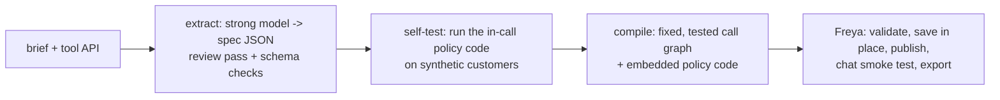

# Build the Builder: phone-agent builder

A program that reads a bank's documents (a folder of Markdown, Word, PDF, Excel, images, or a single brief) and the
address of the bank's services, and creates a phone agent (a Freya workflow).

```bash
cp env.example env.sh         # FREYA_API_KEY, FREYA_BANK_TEAM_KEY, AI_GATEWAY_API_KEY
source env.sh
python3 builder/build.py <case_folder> <mock_url> 2>&1 | tee traces/final.log      # folder of documents + service URL
python3 builder/build.py <brief.md> <tool_api.json> 2>&1 | tee traces/<brief>.log  # practice format
```

Two modes, chosen per case (logged in the trace; `BUILDER_MODE=design|collections` overrides):

- **collections**: outbound debt-collection calls with promises. A spec is extracted and compiled into a fixed, tested
  call graph with deterministic policy code (below).
- **design**: any other call. A strong model designs the call flow from the documents (resolving conflicts between
  documents by date), writes the workflow, which is validated and repaired, published, and then tested in simulated
  chats built from the documents' example conversations; failures are fed back for revision.
  `BUILDER_SELFTESTS` (default 2) and `BUILDER_TEST_TURNS` (default 6) size that test.

Ingestion (`builder/ingest.py`): text files, Word, Excel, PowerPoint, HTML, PDF; images, embedded pictures and
flowchart pages are read by a vision model. A service contract without an OpenAPI file is turned into one (pointing at
the given service URL) with the role of each operation.

Python 3.10+, standard library only. The builder's own model calls go through an OpenAI-compatible chat endpoint
(`AI_GATEWAY_API_KEY` for the Vercel AI Gateway, or `LLM_BASE_URL` + `LLM_API_KEY`). The model is `BUILDER_MODEL`
(default `anthropic/claude-opus-5.5`), with `BUILDER_FALLBACK_MODELS` tried if it fails. `LLM_BUDGET_USD` caps the builder's spend.
The phone agent runs on the event model set in `freya.py`.

## How it works



1. **Extract** (`builder/extract.py`, `builder/spec_guide.md`). A strong model turns the brief into a spec: identity questions,
   bands and deadlines, calendar, floors, persuasion steps, callback window, situations (hardship, paid, dispute, transfers),
   outcome and reason codes, exact sentences. A second pass reviews the spec rule by rule against the brief; a checker
   validates every code against the tool API's enums. Raw bank material (mails, memos, code lists) is merged with later
   memos overriding earlier text.
2. **Self-test.** The policy code that will run inside the call is executed locally on synthetic customers from the spec
   (every band, one and three products): refusals use up the persuasion steps, late dates are corrected, outcomes come out right.
3. **Compile** (`builder/compile.py`). A fixed call graph: opening, third party and callback, one step per security question,
   account, negotiation, read-back, recording with one retry, notes, close. Everything that can be computed is computed in
   Python inside the workflow (`builder/runtime/policy.py`): business days, deadlines, allowed dates, floors, persuasion
   offers, the read-back text, which promises to record, notes and the final outcome. The phone agent's model only talks and
   reports what the customer said through one `assess` tool; `create_promise`, `add_note`, `transfer_to_agent` and `close_call`
   are fired by the workflow, never guessed by the model.
4. **Publish and export.** Dry-run validation, save in place (one workflow per brief), publish, a chat smoke test, and
   `freya.export_workflow` to `submission/<brief>.workflow.json`.

Every run writes a trace to `traces/<brief>-<time>.log`: start and end time, each model call (model, purpose, tokens, cost),
the spec coverage list, self-test results, the workflow and agent ids, and the smoke test.

## Layout

| Path | What |
|---|---|
| `builder/build.py` | Entry point |
| `builder/extract.py`, `builder/spec_guide.md`, `builder/example_spec.json` | Brief -> spec (example spec is from the public briefs A+B) |
| `builder/compile.py` | Spec + tool API -> workflow |
| `builder/runtime/policy.py` | Policy code embedded in the workflow's code steps |
| `builder/llm.py` | Model client with a spend cap (`LLM_BUDGET_USD`) |
| `specs/` | Hand-written specs for the public briefs (development reference) |
| `builder/ingest.py`, `builder/design.py` | Document ingestion; design mode |
| `mock/` | Our mock of the bank's services (Cloudflare Worker); not part of the builder |
| `lab/` | Development tools: local parallel case harness, policy tests, variant briefs |
| `freya.py`, `tools/`, `docs/`, `briefs/`, `public-test-set.json` | From the organisers' kit (v3) |
